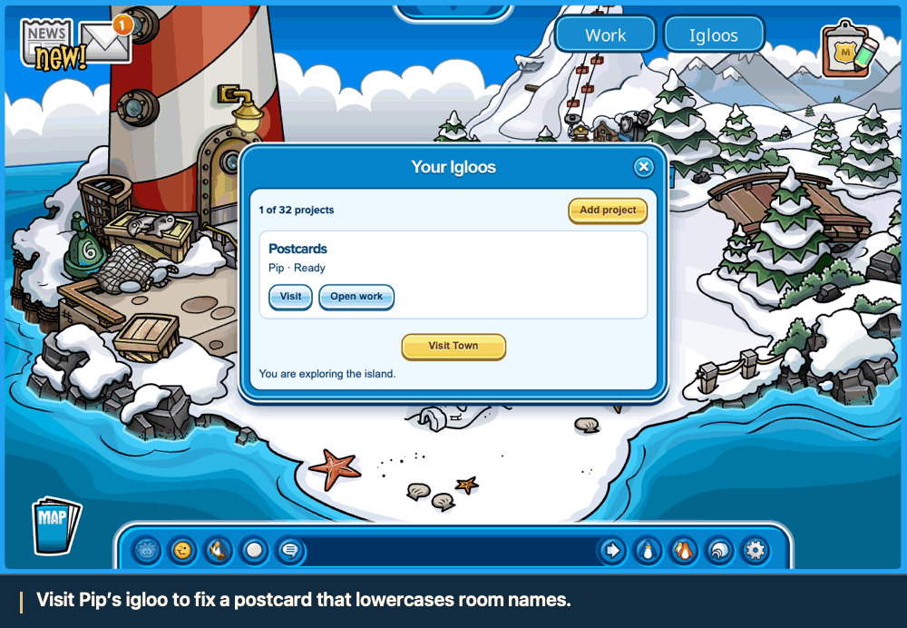
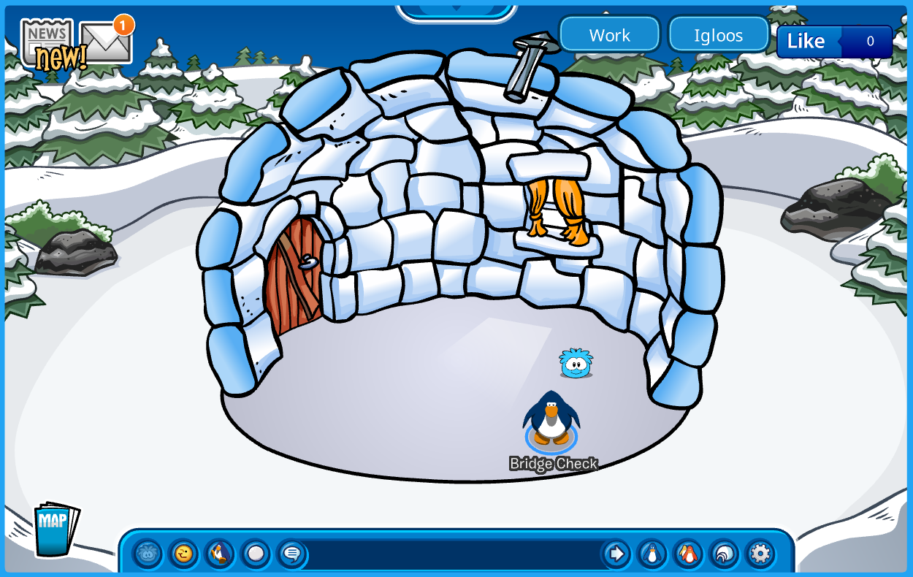
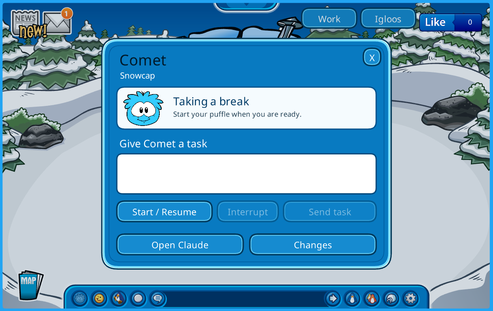
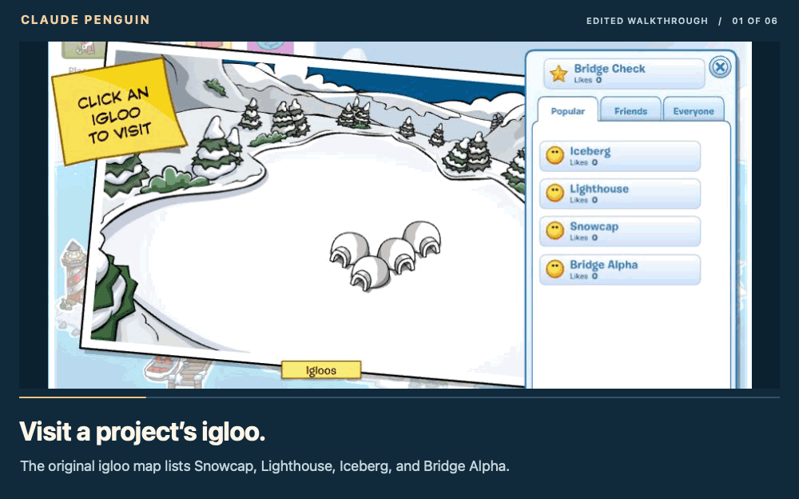

# Claude Penguin

**Your repo gets an igloo. Your coding agent is a puffle.**

Click a puffle in the original Club Penguin to give Claude Code a task. Waddle back to Town while it works. When the **Work** badge lights up, open the terminal or review the diff. The island runs on your Mac; each puffle has its own Git worktree.

[Try it on your Mac](#play-locally) · [Give a puffle its first bug](docs/first-task.md) · [Roadmap](#product-roadmap)



**Pip’s first bug:** a postcard from “Coffee Shop” came out as “coffee shop.” The task went through the in-game card. Pip changed one line; the unchanged test passed in its worktree. The clip is edited from that playthrough. [Watch or save the MP4](docs/assets/pip-fixes-a-postcard.mp4) · [Reproduce the fix](docs/first-task.md)

## A lap around the island

| In the game | What happens on your Mac |
| --- | --- |
| **Igloos → Add project** | Choose a local Git repo and name its puffle. Its igloo appears in the original map’s igloo list. |
| **Visit → click the puffle** | Its task card opens inside the game. **Start / Resume** opens a Claude session for that repo. Send a task from the card; use **Open Claude** for trust and permission prompts. |
| **Walk into Town** | The session keeps running. **Work (2)** means two puffles need attention. **Work** reopens your selected puffle; **Igloos** lets you pick another. |
| **Open Changes** | Inspect the files Claude actually changed. Copy the branch or worktree path when you’re ready to test or integrate the change with Git. |

| Snowcap’s igloo | Click Comet to open the task card |
| :---: | :---: |
| [](docs/assets/snowcap-igloo.png) | [](docs/assets/inside-the-igloo.png) |

Register up to **32 repositories**, with **one active puffle per repo**. Puffles in different igloos can work at the same time. Reloading the browser reconnects to a running session; after stopping the engine, **Start / Resume** returns to the same saved conversation.

<details>
<summary><strong>See two puffles working at once:</strong> Comet, Nova, and Work (2) in Town</summary>



*From a real two-puffle run:* Comet wrote `comet.txt` for Snowcap and Nova wrote `nova.txt` for Lighthouse. The penguin traveled to Town while both Claude sessions stayed live. The GIF is an edited sequence of in-game and terminal screenshots. [What we verified](local/VALIDATION.md#interactive-and-persistence-evidence)

</details>

## Play locally

The supported setup is **macOS with Colima**. You can explore the island without a Claude account, or turn on the host engine to work with a puffle.

**1. Start the island.** With Homebrew, Git, and Python 3 installed:

```sh
brew install colima docker docker-compose
git clone https://github.com/Robert-Conover/claude-penguin.git
cd claude-penguin
./local/start
```

First launch fetches about **4.1 GB of archived game media** plus Ruffle and builds the services. For ordinary play, open [localhost:8080](http://localhost:8080/) and sign in as `player` with the disposable local password `PenguinLocal2026!`.

**2. Turn on the puffles.** You’ll need **Git 2.48+, Python 3.9+, Node.js 22+, npm, a JDK**, and [Claude Code](https://code.claude.com/docs/en/setup) signed in on your Mac. From the same repository, with the game running:

```sh
python3 local/client-bridge/build.py
./local/agent-start
```

Keep that terminal open. Open [the agent island on localhost:8081](http://localhost:8081/?bridge=1&agents=1#/login), sign in as **`bridgecheck`** with the same disposable password, and choose **Blizzard**. Open **Igloos → Add project** and enter the path of a local repo with at least one commit. For a first visit, try **[Puffle Postcards](docs/first-task.md)**: one small bug, one failing test, and a diff you can check yourself.

**Done for the day?** Press Ctrl+C in the engine terminal, then run `./local/stop` to stop the island and keep your progress. [Game setup & troubleshooting](LOCAL_SETUP.md) · [Agent setup & permissions](local/AGENT_ENGINE.md)

## Product roadmap

| Status | Milestone |
| --- | --- |
| **Playable** | Explore the original AS3 island through Ruffle. Login, travel, shops, purchases, and puffle adoption and walking have been checked. Player progress survives a restart. |
| **Working today** | A repo has its own visitable igloo, named puffle, branch and worktree. Submit tasks inside the game, answer Claude in a real terminal, review changes, and resume the conversation. Two puffles have worked concurrently across two repos. |
| **Next** | Give one repo a team of puffles, each working on its own branch. Make it clear which changes belong to whom and how to bring them together. |
| **Later ideas** | A task board inside the igloo and temporary helper puffles for work a session delegates. |
| **Still to verify** | Finish a minigame and collect its reward during a live Claude task; check furniture placement and puffle care in the browser; verify each puffle animation against the real agent state. |

The [dated validation notes](local/VALIDATION.md) separate browser playtests and real Claude runs from automated tests. Cart Surfer has reached active gameplay; a completed round and payout are still open.

## How it works

The archived Flash client runs in the browser through [Ruffle](https://ruffle.rs/). Houdini and the other game services run in Docker. A [client overlay](local/client-bridge/README.md) adds the native menus and puffle clicks without rewriting the archived media. On the Mac, the [host engine](local/AGENT_ENGINE.md) starts the Claude Code terminal, routes tasks to the selected puffle, and sends its status back to the game.

The game and engine listen on loopback. Claude uses its normal host authentication and permissions. Each worktree starts at the registered repo’s current commit; uncommitted edits stay in the original checkout.

## Credits & contributing

Built on [Solero Wand](https://github.com/solero/wand), [Houdini](https://github.com/solero/houdini), [Dash](https://github.com/solero/dash), [Snowflake](https://github.com/Lekuruu/snowflake), Ruffle, and the community’s archived AS3 client. See the [pinned sources](local/sources.json) and [upstream MIT license](LICENSE.md). The game media is a separate submodule; the Wand license does not cover Club Penguin artwork or assets. Claude Penguin is an unofficial fan project, unaffiliated with Disney or Anthropic.

Contributions go to `dev`; releases go from `dev` to `main` by pull request. See [Contributing](CONTRIBUTING.md) for the workflow and [AGENTS.md](AGENTS.md) for repository guidance.
