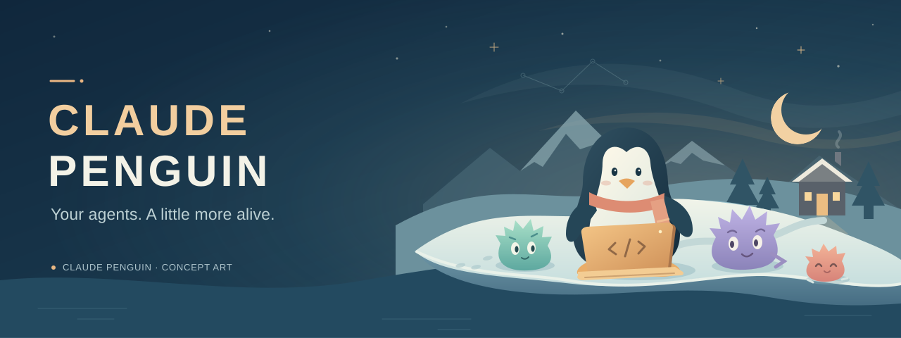

<p align="center">
  
</p>

<h1 align="center">Claude Penguin</h1>

<p align="center">
  <strong>Your coding agents. Their own little world.</strong><br>
  Bringing Claude Code to Club Penguin, one puffle at a time.
</p>

<p align="center">
  <a href="#the-idea">The idea</a> ·
  <a href="#where-things-stand">Current status</a> ·
  <a href="#product-roadmap">Roadmap</a> ·
  <a href="#play-locally">Play locally</a> ·
  <a href="CONTRIBUTING.md">Contribute</a>
</p>

> **Early development:** the original game runs locally, and an opt-in engine connects one puffle to a real Claude Code terminal. A real coding task and manual permission handling have passed through the host engine; full in-game acceptance remains in progress. The banner is concept art.

## The idea

What if your coding agents lived in Club Penguin?

**A repository is an igloo. A puffle is a persistent, named Claude Code session.** Give a puffle a task, explore the island, and open **Work** when it needs you. Sessions can keep running while you travel, as long as the local host runtime stays running.

That's the idea behind Claude Penguin: the original game's rooms, penguins, and puffles, with a new reason to hang out on the island. The starting point is the full game client, including town, shops, rooms, and minigames. The first coding-agent connection is now available as an experiment.

## Where things stand

| | Today |
| :--- | :--- |
| 🐧 **Explore the island** | The AS3 client runs through Ruffle in the browser. Login, walking, room travel, and the introductory tour have passed interactive checks. |
| 🛍️ **Make it yours** | Catalog browsing, purchases, equipped color, and puffle adoption and walking have been checked in Safari. |
| 💾 **Keep your progress** | Local accounts and game state persist. Backend reconnect and stack-restart checks passed. |
| 🎮 **Keep testing** | Cart Surfer reaches active gameplay. Completed rounds, rewards, browser furniture placement, and some other interactions still need verification. |
| ✨ **Work with a puffle** | The opt-in [agent engine](local/AGENT_ENGINE.md) connects Atlas to one repository and a named Claude Code session. Clicking Atlas or **Work** opens its native in-game task card. The real terminal and changes viewer open as secondary windows. |
| 🔄 **Pick up where you left off** | Task history, terminal reconnect, exact-session resume, and failure/attention reporting have been checked. Traveling leaves the session running; stopping it preserves the conversation for later resume. |

**Current scope:** one registered repository and one puffle, using a dedicated fixture igloo. The worker edits that repository's checkout directly; isolated worktrees and multiple projects are still planned. The destination chooser uses matching browser styling; the puffle card and Work/Igloos controls render inside Flash.

**Latest agent evidence:** after sign-in, Claude produced a real greeting fix and two passing tests in a disposable repository, with one-time manual approvals. These checks used the host API and real terminal. **Still to prove:** native task submission with successful model output, travel and notifications during real work, and runtime animation acceptance. Browser access was unavailable during the latest pass. Cancellation without a confirming terminal signal now requests attention; it is not reported as confirmed interruption. See the dated [validation record](local/VALIDATION.md) for the exact tested scope and remaining gameplay checks.

## Product roadmap

Checked milestones are implemented within the scope shown. Unchecked rows track the next product work and remaining acceptance checks.

| Status | Milestone | What it delivers |
| :---: | :--- | :--- |
| ☑&nbsp;Built | **Local island** | Original client running locally, core exploration and shops, puffles, and persistent player state. |
| ☑&nbsp;Built | **Game bridge** | Two fixture igloos with explicit identities, real puffle clicks, and animation controls. |
| ☑&nbsp;Built | **Persistent puffle session** | One repository and named Claude terminal, lifecycle status, task history, reconnect/resume, and changes review. |
| ☑&nbsp;Built | **Native puffle menus** | In-game Work/Igloos buttons and task card, original puffle artwork, and drafts retained across secondary views. |
| ☐&nbsp;Next | **Complete the in-game agent loop** | Submit through the native card, travel to Town during real work, handle attention, and return to review Claude-generated changes with accurate status cues. |
| ☐&nbsp;Planned | **Your Igloos neighborhood** | A map destination for multiple repositories, each with its own igloo, activity count, and separate project state. Work stays accessible across the island. |
| ☐&nbsp;Planned | **Multiple puffles per project** | Concurrent agents with isolated branches/worktrees and explicit review and integration actions. |
| ☐&nbsp;Planned | **Project coordination** | Task boards, useful furniture interactions, and temporary helper puffles for delegated work. |
| ☐&nbsp;Ongoing | **Gameplay acceptance** | Completed minigame rounds and rewards, browser furniture placement and puffle care, agent/minigame coexistence, and broader display checks. |

The next demo target: **give a puffle a real coding task, walk into Town, get notified when it needs you, and return to review an actual change.** Puffle colors stay cosmetic; labels and animations communicate work status.

## Play locally

The current launcher targets **macOS with Colima**. The baseline was verified on Apple Silicon using Safari.

You need Git, Python 3, Homebrew, and the standard macOS `curl` and `unzip` tools. Install the container tools:

```sh
brew install colima docker docker-compose
```

Then get the project and start the island:

```sh
git clone https://github.com/Robert-Conover/claude-penguin.git
cd claude-penguin
./local/start
```

Open **[localhost:8080](http://localhost:8080/)**.

| Local account | Password |
| :--- | :--- |
| `player` | `PenguinLocal2026!` |

This disposable development account starts with membership and 100,000 coins. No Claude Code account or API key is needed to try the current game baseline.

The first launch downloads the pinned media submodule (about **4.1 GB of archived media**) and Ruffle, then builds the services. The dedicated VM is configured with 4 CPUs, 4 GB RAM, and a 30 GB disk. Published service ports bind to localhost.

```sh
./local/stop    # Stop the containers and dedicated VM; keep player progress.
```

For logs, troubleshooting, and verification commands, see [LOCAL_SETUP.md](LOCAL_SETUP.md).

### Try the puffle engine

For the optional coding experiment, you also need **Node 22+, npm, a JDK, and Claude Code signed in on the Mac**. With the baseline game running:

```sh
python3 local/client-bridge/build.py
./local/bridge-fixtures
./local/agent-start
```

Open **[the agent page on localhost:8081](http://localhost:8081/?bridge=1&agents=1#/login)**. Follow the [agent setup guide](local/AGENT_ENGINE.md) for the dedicated `bridgecheck` login, repository registration, permissions, and session controls. Keep the host runtime terminal open while agents work; starting the game alone does not start Claude.

## Under the snow

The browser runs the original Flash client through **Ruffle**. A small Node.js wrapper serves the game and bridges its sockets to **Houdini**, with **Dash**, **Snowflake**, PostgreSQL, and Redis supporting the local world.

The optional host engine runs Claude Code in a real terminal on the Mac, persists project/session identity, and streams terminal output and lifecycle events to the game wrapper. The native menu bridge adds controls through a generated client overlay while preserving the original engine tags and upstream sources. Provider credentials stay on the host.

| Path | What's there |
| :--- | :--- |
| [`local/`](local/) | Mac launcher, game wrapper, compatibility adapters, and verification helpers |
| [`local/engine/`](local/engine/) | Host Claude sessions, persistence, lifecycle hooks, and terminal streaming |
| [`local/client-bridge/`](local/client-bridge/) | Native menu and puffle-click bridge, overlay build, and artwork export |
| [`local/web/engine/`](local/web/engine/) | Browser setup, terminal, changes viewer, and fallback puffle card |
| [`local/sources.json`](local/sources.json) | Exact upstream revisions and the Ruffle release/checksum |
| `houdini/`, `dash/`, `snowflake/` | Vendored community server sources (MIT; revisions in `local/sources.json`) |
| `vanilla-media/` | Pinned archived client and game media (Git submodule) |

The client archive is the later AS3 generation of original Club Penguin. It is not a claim of an exact, complete final-day snapshot. The legacy AS2 media is not downloaded by the local launcher.

## Build with us

Development happens on **`dev`**. Promotions go **`dev` → `main`** through pull requests; there is no `qa` branch.

Start with [CONTRIBUTING.md](CONTRIBUTING.md). Coding agents use [AGENTS.md](AGENTS.md); Claude Code has a [shared-guidance entry point](CLAUDE.md). Reproducible bug reports and focused contributions are welcome, especially around the remaining gameplay checks.

## Credits

This project builds on the preservation and server work of [Solero Wand](https://github.com/solero/wand), [Houdini](https://github.com/solero/houdini), [Dash](https://github.com/solero/dash), [Snowflake](https://github.com/Lekuruu/snowflake), the archived vanilla-media client, and [Ruffle](https://ruffle.rs/).

Upstream history and the [Wand MIT license](LICENSE.md) are preserved. Referenced components retain their own licensing; the Wand license does not grant rights to Club Penguin artwork or other game assets.

Claude Penguin is an unofficial experiment, unaffiliated with Disney or Anthropic.
